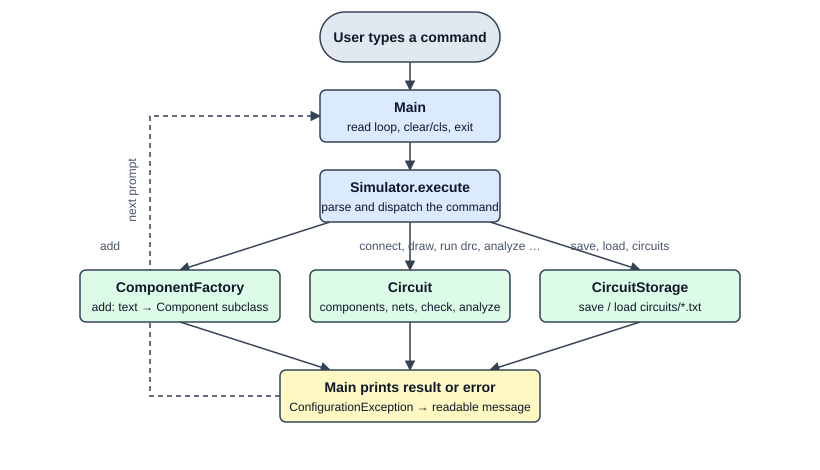
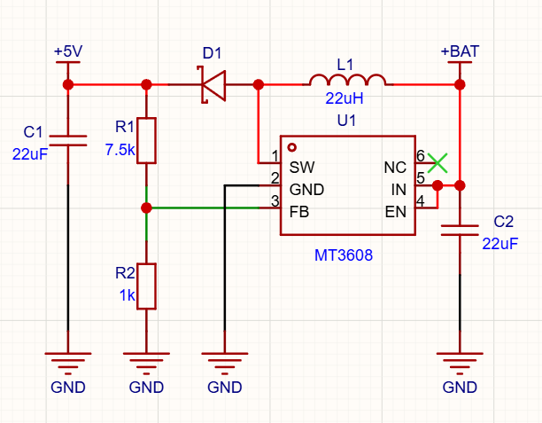
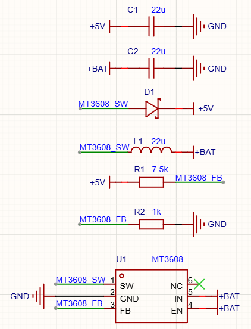

# ConsolAS-CII

Console schematic builder written in Java 17. The user places electronic components, connects their pins,
and gets an ASCII drawing, a design rule check and simple calculations (voltage regulator, Li-ion charger,
boost converter) without any GUI.

The example circuit used in this README is a **5 V boost converter built around the MT3608**,
powered from a Li-ion battery (+BAT).

## Prerequisites

- JDK 17 or newer
- Maven 3.8 or newer

## Build and run

Run all commands from the repository root (the program reads `config.properties` and saves circuits to `circuits/` in the current folder).

```
mvn clean package
java -jar target/ConsolAS-CII-1.0.0.jar
```

`mvn clean package` also runs the unit tests (JUnit 5). Run only the tests with `mvn test`.

On Windows, for the box-drawing characters, run `chcp 65001` in the terminal before starting the program.
The `clear` / `cls` command needs a real terminal (it does nothing in the IntelliJ Run window).

## How it works



`Main` reads a line, `Simulator` parses it and calls `ComponentFactory` (add), `Circuit` (wiring, check, analysis)
or `CircuitStorage` (save / load). Errors are reported as readable messages, the program keeps running.

## Sample usage

Example circuit: MT3608 step-up converter, +BAT (3.0-4.2 V) to +5 V.
The output voltage is set by the divider R1 / R2: `Vout = 0.6 V * (1 + R1 / R2)`.

### Expected schematic

The circuit drawn in an EDA tool. This is what we want to build with the program:



### Build it in the console

```
# Add the needed components
> add capacitor 22uF
C1 added: capacitor 22u
> add capacitor 22uF
C2 added: capacitor 22u
> add MT3608
U1 added: MT3608 (2A step-up converter)
> add diode
D1 added: diode
> add resistor 7.5k
R1 added: resistor 7.5k
> add resistor 1k
R2 added: resistor 1k
> add inductor 22uH
L1 added: inductor 22u

# Connect pins to pins; GND is a named net, the others get automatic names (N1, N2, ...)
> connect U1.1 L1.1
U1.1 -- L1.1  (net N1)
> connect U1.1 D1.anode
U1.1 -- D1.ANODE  (net N1)
> connect U1.2 GND
U1.2 -- GND  (net GND)
> connect U1.3 R1.2
U1.3 -- R1.2  (net N2)
> connect U1.3 R2.1
U1.3 -- R2.1  (net N2)
> connect R1.1 D1.Cathode
R1.1 -- D1.CATHODE  (net N3)
> connect R2.2 GND
R2.2 -- GND  (net GND)
> connect U1.4 U1.5
U1.4 -- U1.5  (net N4)
> connect U1.5 C2.1
U1.5 -- C2.1  (net N4)
> connect C2.1 L1.2
C2.1 -- L1.2  (net N4)
> connect C2.2 GND
C2.2 -- GND  (net GND)
> connect C1.1 R1.1
C1.1 -- R1.1  (net N3)
> connect C1.2 GND
C1.2 -- GND  (net GND)

# Give the nets meaningful names
> rename net N1 MT3608_SW
> rename net N2 MT3608_FB
> rename net N3 +5V
> rename net N4 +BAT
```

Pins can be given by number (`U1.1`) or by name (`D1.anode`). Connecting two pins creates a net,
connecting a pin to a name (`GND`) creates or joins a named net.

### Check the result (ASCII output)

```
> draw
C1  capacitor 22u
    +5V ───┤├─── GND

C2  capacitor 22u
    +BAT ───┤├─── GND

D1  diode
    MT3608_SW ───|>|─── +5V

L1  inductor 22u
    MT3608_SW ───((((((─── +BAT

R1  resistor 7.5k
    +5V ───[ 7.5k ]─── MT3608_FB

R2  resistor 1k
    MT3608_FB ───[ 1k ]─── GND

U1  MT3608 (2A step-up converter)
                ┌─────────────┐
    MT3608_SW ──┤ 1 SW   NC 6 ├── NC
          GND ──┤ 2 GND  IN 5 ├── +BAT
    MT3608_FB ──┤ 3 FB   EN 4 ├── +BAT
                └─────────────┘

> nets
+5V:       R1.1, D1.CATHODE, C1.1
+BAT:      U1.EN, U1.IN, C2.1, L1.2
GND:       U1.GND, R2.2, C2.2, C1.2
MT3608_FB: U1.FB, R1.2, R2.1
MT3608_SW: U1.SW, L1.1, D1.ANODE
```

Each line of `draw` shows one part with the nets on its two sides (an IC is drawn as a box with its pins).
Compare it with the real schematic: the same circuit, each part drawn with net labels
(`NC` means not connected):



### Design rule check and analysis

```
> run drc
OK, no problems found

> analyze U1
ERROR: Usage: analyze U1 <input voltage> [load current]
example: analyze U1 5 200m

> analyze U1 3.7V 600mA
U1 analysis
  Vin   = 3.7 V
  Vout  = 5.1 V (set by R1 and R2)
  Iout  = 0.6 A
  Duty  = 27.5 %
  Iin   = 0.973 A (at 85.0 % efficiency)
  Loss  = 0.54 W
```

`run drc` looks for wiring mistakes (for example a missing diode on the SW net or an unconnected required pin).
`analyze` calculates the output voltage from the divider, the duty cycle, the input current and the losses.
The wrong call above shows the error message; the program keeps running after any error.

### Save and load

```
> rename circuit MT3608_Battery_5V_step_up
> save
Circuit 'MT3608_Battery_5V_step_up' saved
> exit
```

At the next start:

```
> circuits
Saved circuits:
1 - MT3608_Battery_5V_step_up.txt
> load 1
Circuit 'MT3608_Battery_5V_step_up' loaded
> load MT3608_Battery_5V_step_up
Circuit 'MT3608_Battery_5V_step_up' loaded
```

The files are saved in the `circuits/` folder, a loaded circuit can be loaded by number or by name.
A complete console session of this example is in [docs/example-program.txt](docs/example-program.txt).

Other commands: `components [sort ref|type|value]`, `show pins <ref>`, `disconnect`, `remove`, `new <name>`,
`clear`, `help`, `exit`. Type `help` for the full list.

## Configuration

Constants such as reference voltages and limits are in `config.properties`. If the file is missing,
built-in default values are used.

## Implemented requirements

- Domain model with abstraction, inheritance and polymorphism: `Component` -> `TwoPinComponent` / `IC` -> concrete parts.
- Relationships: `Circuit` has components and nets, components have pins, pins belong to nets.
- Validation and exception handling: `ConfigurationException`, readable messages, no crash on wrong input.
- Persistence: circuits are saved to and loaded from text files (`circuits/<name>.txt`).
- Sorting: `components sort ref|type|value` with `Comparator` and `Comparable`.
- Design pattern: Factory (below).
- Unit tests: JUnit 5 (`src/test`).
- Docs: [problem statement, user stories, UML and design](docs/).

## Design pattern: Factory

`ComponentFactory.create(type, value)` converts the typed text (`R`, `resistor`, `AMS1117-3.3`, ...) into a
`Component` subclass. `Simulator` and `CircuitStorage` only know the abstract `Component`, so a new part needs one
new subclass and one new case in the factory, and no command changes. Details and the UML diagram: [docs/](docs/).

## Contributors

- Kőszegi Patrik ([paco7828](https://github.com/paco7828))

## License

MIT, see [LICENSE](LICENSE).